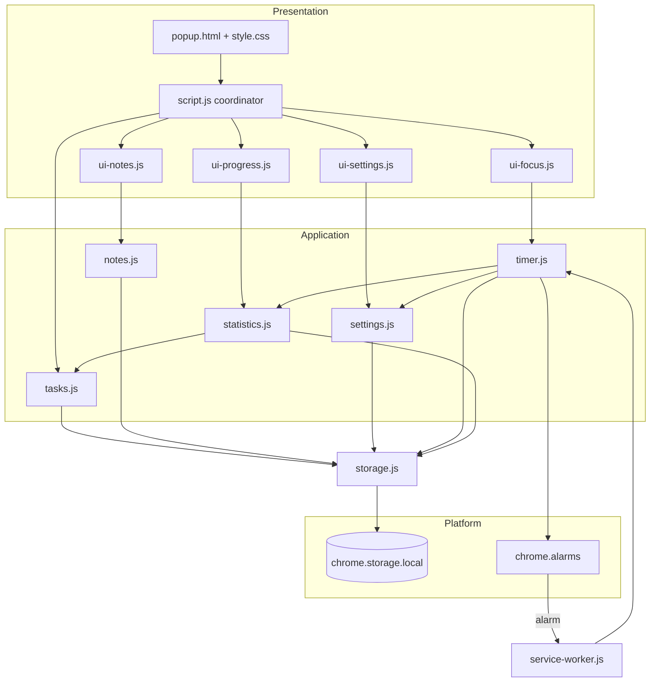
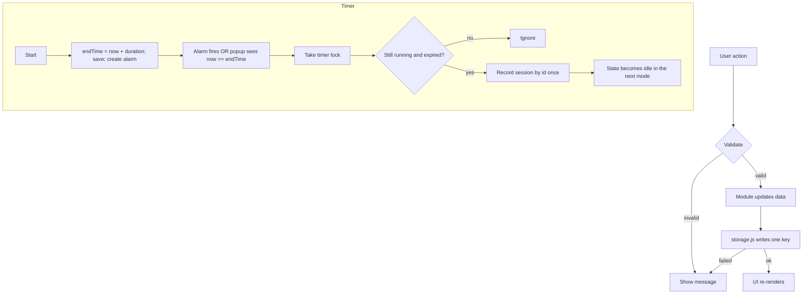
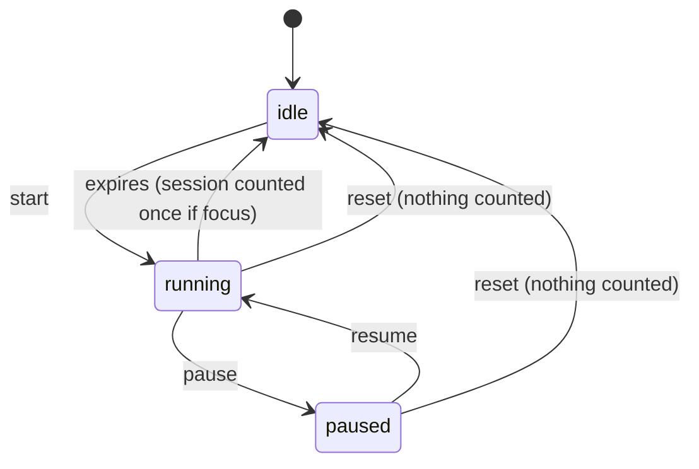

# FocusFlow - Student Productivity Companion

A local-first Chrome extension (Manifest V3) that combines a task manager, a Pomodoro focus timer,
quick notes and a daily progress dashboard in one popup.

## Problem statement
Students often juggle separate apps for tasks, study timers and notes. That friction makes it harder
to keep a steady routine. FocusFlow puts all three in one lightweight popup, with no account and no server.

## Features
- **Tasks:** add (title 1-200 characters, optional due date), edit, complete/reopen, delete with confirmation, filters, counts.
- **Focus timer:** focus / short break / long break, start, pause, resume, reset, mode switching. Next session never auto-starts.
- **Notes:** create, edit, delete with confirmation, debounced autosave with visible save status.
- **Progress:** today's completed tasks, focus sessions and minutes; task totals and completion percentage; all-time focus totals.
- **Settings:** durations, sessions before a long break, light/dark theme, "reset all data" with typed confirmation.

## Screenshots
_Placeholders. Screenshots will be added after the extension has been run and tested._

| Tasks | Focus | Notes | Progress |
|---|---|---|---|
| _(pending)_ | _(pending)_ | _(pending)_ | _(pending)_ |

## Technology stack
HTML5, CSS3, vanilla JavaScript (ES modules), Chrome Extensions Manifest V3 (`chrome.storage.local`,
`chrome.alarms`, service worker). No frameworks, no bundler, no runtime dependencies.

## Architecture overview
Two JavaScript contexts share `chrome.storage.local`: the **popup** (UI, created on click, destroyed on close)
and the **service worker** (wakes for alarms, can be suspended at any time). Nothing important is kept in memory.



### Data flow


### Timer states


## File structure
```
FocusFlow/
├── manifest.json  popup.html  style.css  script.js  service-worker.js
├── README.md  LICENSE  .gitignore
├── js/  config.js storage.js tasks.js settings.js statistics.js timer.js notes.js
│        ui-focus.js ui-notes.js ui-progress.js ui-settings.js
├── assets/icons/  icon16.png icon32.png icon48.png icon128.png
└── tools/make-icons.js   (dev-only icon generator, not used at runtime)
```

## Storage design
All timestamps are epoch milliseconds. Calendar days are local `"YYYY-MM-DD"` strings.

| Key | Shape | Written by |
|---|---|---|
| `tasks` | `[{id, title, completed, createdAt, dueDate, completedAt}]` | `tasks.js` (popup) |
| `notes` | `[{id, title, content, createdAt, updatedAt}]` | `notes.js` (popup) |
| `settings` | `{schemaVersion, focusMinutes, shortBreakMinutes, longBreakMinutes, sessionsBeforeLongBreak, theme}` | `settings.js` (popup) |
| `timerState` | `{status, mode, sessionId, durationSeconds, endTime, remainingSeconds, cycleFocusCount, lastCompletedSessionId}` | `timer.js` (popup + service worker, under a lock) |
| `dailyStats` | `{"YYYY-MM-DD": {sessions: [{id, durationSeconds, completedAt, dev}]}}` | `statistics.js`, only via the timer lock |

Statistics are derived from tasks and the session list, not from separate counters.
Invalid stored values are repaired per key at startup (a warning is shown, the original is logged to the console).

## Local installation
1. Download or clone this folder.
2. Generate icons once: `node tools/make-icons.js` (or provide your own PNGs).
3. Open `chrome://extensions`, enable **Developer mode**, click **Load unpacked**, select the `FocusFlow` folder.
4. Pin the extension and open it from the toolbar.

## Testing
Follow the manual test plan (install, tasks, timer, notes, statistics, settings, security). For fast timer tests set
`DEV_MODE = true` in `js/config.js`, reload the extension, and set it back to `false` afterwards.
Test results are recorded by you; none are claimed here.

## Permissions
| Permission | Why |
|---|---|
| `storage` | Save tasks, notes, timer state, statistics and settings on this device. |
| `alarms` | Wake the background worker when a timer session ends. |

No host permissions, no `tabs`, no `history`, no content scripts.

## Privacy and data handling
- All data stays on your device in `chrome.storage.local`.
- FocusFlow makes no network requests, has no analytics, ads or tracking, and loads no remote code.
- Data is deleted by Settings, then "Reset all data" (type DELETE to confirm), or by removing the extension.
- Chrome's local storage is not encrypted by the extension. Do not store secrets in notes.

## Known limitations
- `chrome.storage.local` has no transactions. Double-counting is prevented with a Web Locks mutex plus unique session IDs, which is a design that must be tested, not a proof.
- A final autosave when the popup closes is best-effort. Chrome may destroy the popup before an asynchronous write completes.
- Alarms can fire late, and Chrome may enforce a minimum alarm delay. The timer's time always comes from `endTime`, so lateness does not corrupt the time.
- Selected tab and task filter are not remembered between popup opens.
- Only the active timer state is stored. Old daily statistics are not pruned.
- The completion signal is a toolbar badge ("DONE"). There are no desktop notifications or sounds.

## Future roadmap (not implemented)
Browser notifications, keyboard shortcuts, JSON export/import, weekly charts, new-tab dashboard.

## Credits and third-party licenses
All code is original. No third-party libraries, fonts or icons are used. The icon generator writes simple placeholder PNGs.

Licensed under the MIT License (see `LICENSE`).